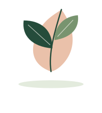
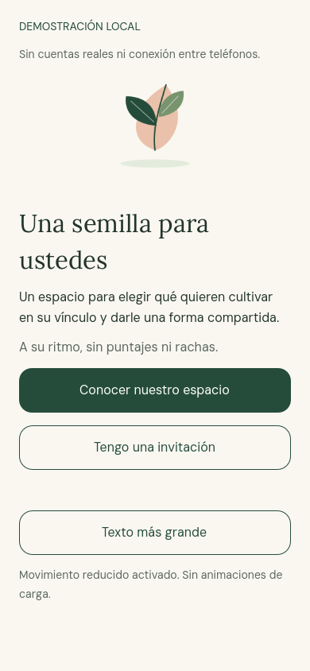
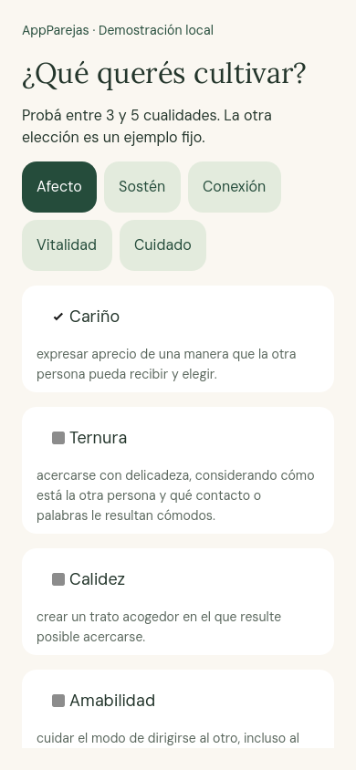
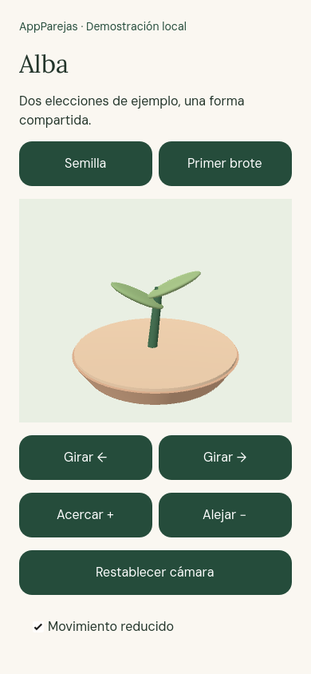

<p align="center">
  
</p>

<h1 align="center">AppParejas</h1>
<p align="center"><strong>Una semilla para ustedes.</strong><br />Un espacio para elegir qué cultivar en un vínculo y darle una forma compartida.</p>

<p align="center">
  
  
  
  
</p>

<p align="center">
  <a href="#vista-previa">Vista previa</a> ·
  <a href="#probar-en-local">Probar en local</a> ·
  <a href="#estado-del-producto">Estado del producto</a> ·
  <a href="docs/AVANCE_MVP.md">Roadmap</a>
</p>

## La idea

Dos personas eligen las cualidades que quieren cultivar en su relación. Sus elecciones darán lugar a una semilla digital y un jardín compartido: una representación visual del acuerdo, pensada para construirse con consentimiento y al ritmo de ambas personas.

La experiencia combina una interfaz cálida, un catálogo de veinte cualidades y una escena 3D. El concepto prioriza el consentimiento explícito, el aporte equivalente de cada integrante y una experiencia sin puntajes ni rachas.

## Vista previa

<p align="center">
  
  
  
</p>

<p align="center"><sub>Capturas reales de la demostración local renderizadas por Godot. Las selecciones y el crecimiento mostrados usan datos ficticios.</sub></p>

## Estado del producto

| Área | Implementación actual |
| --- | --- |
| Primera apertura | Introducción, navegación y recuperación de la etapa local pendiente |
| Identidad y consentimiento | Acceso por correo con OTP, perfil y consentimiento en el entorno de desarrollo |
| Vínculo bilateral | Invitaciones autenticadas; creación, consulta, revisión, aceptación y cancelación |
| Demostración del jardín | Selección local de 3–5 cualidades, mezcla de ejemplo, semilla y brote 3D |
| Accesibilidad | Texto ampliado, movimiento reducido y comprobaciones de disposición; TalkBack sigue pendiente en la versión principal |
| Próximos bloques | Sesión segura persistente, elecciones compartidas reales, acuerdo, siembra y crecimiento autorizados por el servidor |

**El MVP está en desarrollo.** Las cuentas y el vínculo real cuentan con evidencia de pruebas previas en escritorio y Android. El jardín actual es una demostración; todavía no representa un ciclo compartido completo de producción. La sesión real vive en memoria y requiere un nuevo acceso al reiniciar el proceso.

El [roadmap del MVP](docs/AVANCE_MVP.md) y la [validación de cuentas](docs/CUENTAS_Y_VALIDACION.md) detallan los criterios de cierre y lo que falta comprobar.

## Probar en local

### Escritorio

En Windows, desde la raíz del repositorio:

```powershell
./tools/Start-AppParejas.ps1
# Abrir el editor:
./tools/Start-AppParejas.ps1 -Editor
```

El script obtiene el motor oficial fijado y comprueba su SHA-256. Para usar una instalación existente, pasar `-GodotPath` o definir `APPPAREJAS_GODOT`.

En Linux o macOS, con **Godot 4.7.2** instalado:

```sh
godot --path app
```

Sin configuración local de Supabase, la aplicación abre la **demostración**, identificada en pantalla. Para configurar una instancia propia, usar `app/data/connection.example.json` y seguir la [guía de cuentas](docs/CUENTAS_Y_VALIDACION.md). La configuración real y las credenciales permanecen fuera de Git.

### Android

```powershell
./tools/Install-AndroidTemplates.ps1
./tools/Build-Android.ps1
```

La [guía Android](docs/ANDROID.md) explica los requisitos, la exportación y la instalación. La documentación registra pruebas previas en Samsung SM-S936U1 con Android 16; no se repitieron pruebas físicas al preparar esta publicación.

## Arquitectura

```text
Cliente Godot · GDScript · Compatibility
  ├─ Interfaz: primera apertura, selección y jardín 3D
  ├─ Aplicación: navegación, consentimiento y estados
  ├─ Dominio: catálogo, cualidades y receta de demostración
  └─ Infraestructura: persistencia local e invitaciones
                      │
             Supabase · PostgreSQL
             OTP, RLS e invitaciones autenticadas
```

| Carpeta | Contenido |
| --- | --- |
| `app/` | Código del cliente, escenas, recursos, tipografías y pruebas |
| `backend/` | Configuración reproducible, migración SQL, plantilla de correo y pruebas del vínculo |
| `tools/` | Scripts para abrir, probar, explorar y exportar el proyecto |
| `docs/` | Roadmap, decisiones, accesibilidad, implementación y evidencia |
| `entregables/` | Especificaciones, arquitectura, identidad visual y plantillas de diseño |

## Verificación

```powershell
./tools/Test-AppParejas.ps1
./tools/Test-Backend.ps1
```

La comprobación local del **2 de noviembre de 2026** pasó **1.349 verificaciones** del cliente: 232 de dominio y proyecto, 1.009 de primera apertura y 108 de cuentas. También pasaron las pruebas de migración, permisos, restricciones y aceptación concurrente en PostgreSQL 17 aislado. Estas comprobaciones no certifican el despliegue productivo ni completan la validación física de Android.

La [validación de esta publicación](docs/VALIDACION_PUBLICACION.md) registra el alcance. La [guía de desarrollo](docs/GUIA_DESARROLLO.md) conserva los comandos y el contexto técnico ampliado.

## Diseño y documentación

- [Diseño editable en Figma](https://www.figma.com/design/53oHlGwhPienbccVt3xyVc)
- [Estado y próximos bloques del MVP](docs/AVANCE_MVP.md)
- [Primera apertura y separación demo/real](docs/PRIMERA_APERTURA.md)
- [Accesibilidad en Android](docs/ACCESIBILIDAD_ANDROID.md)
- [Especificación funcional](entregables/AppParejas_Especificacion_funcional_V1.docx)
- [Datos, sincronización y privacidad](entregables/AppParejas_Datos_sincronizacion_y_privacidad_V1.md)

Las fuentes **DM Sans** y **Lora** incluyen sus licencias OFL en `app/assets/fonts/`. El código QR de terceros conserva su atribución y licencia en `app/third_party/qr/`.
